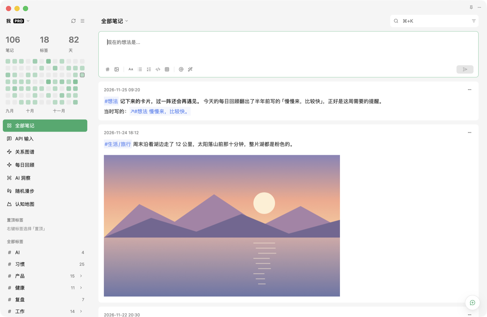
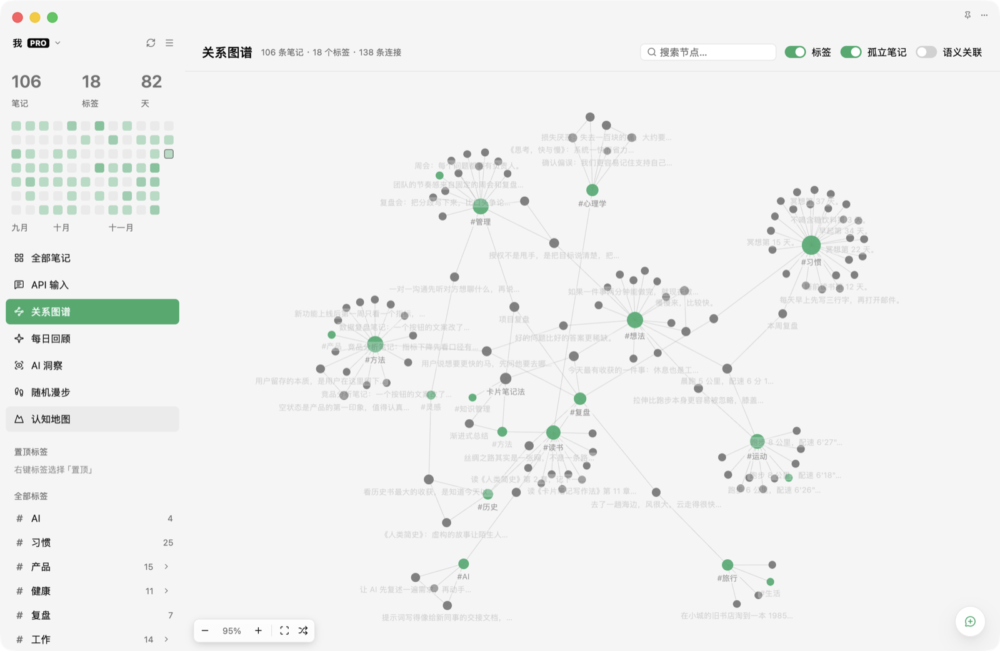
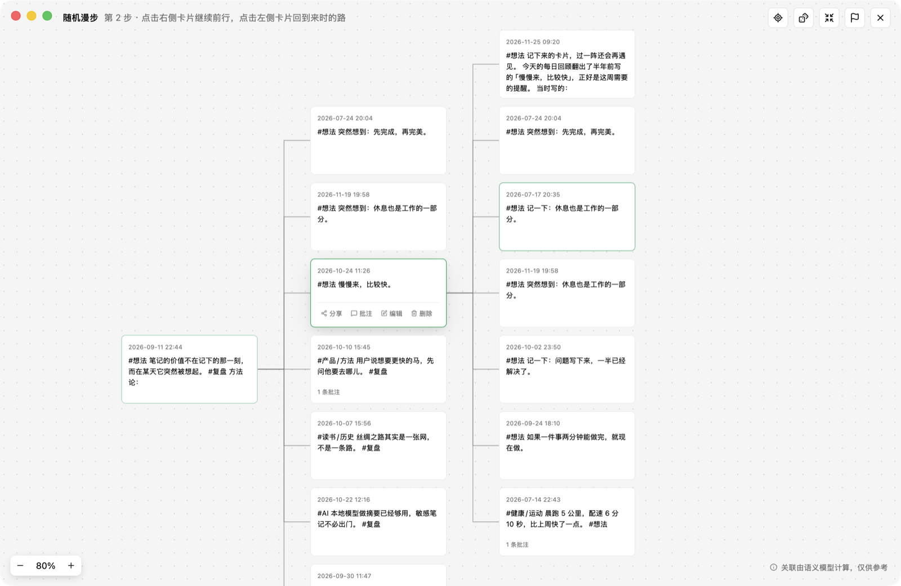
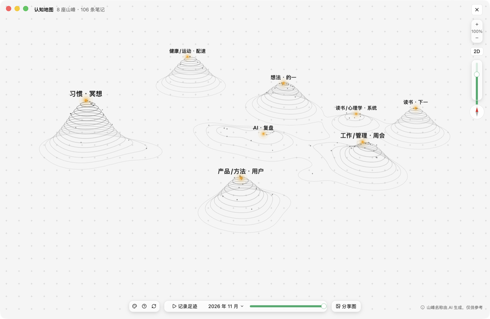

[English](README.md) · [繁體中文](README.zh-Hant.md)

# Mori

记下来的卡片，过一阵还会再遇见。

像 [flomo](https://flomoapp.com) 一样随手记录。每日回顾把旧笔记重新翻出来，随机漫步沿着语义往下走，认知地图把反复思考的主题堆成山。原生 macOS 应用，用 Rust 和 [GPUI](https://gpui.rs) 编写，笔记、图片和设置都在本机。

不配置 AI 也能用：相关笔记、语义搜索、随机漫步和认知地图使用本地 TF-IDF（中文按字二元组、英文按词）。配置兼容 OpenAI 接口的服务后，改为模型向量；只有这时，相关内容才会发到你填写的地址。

界面可以在「设置 → 通用」切换简体中文、English、繁體中文。macOS 12 及以上，Apple Silicon，[MIT](LICENSE) 许可。



| 笔记详情（导入的 Obsidian 笔记） | 关系图谱 |
| --- | --- |
|  |  |

| 随机漫步 | 认知地图 |
| --- | --- |
|  |  |

## 功能

**记录**
- 输入框支持 `#标签`（可多级，如 `#读书/心理学`）、列表，以及 `**加粗**`、`==高亮==`、`__下划线__`、`~~删除线~~`
- 图片写在正文里（``），阅读时显示在原来的位置；编辑时图片块带缩略图，正文下方有预览
- Markdown：标题、代码块、表格、任务列表；YAML 属性显示在笔记顶部；`[[双链]]` 按标题或别名链接笔记
- `@` 引用其他笔记，「批注」给旧笔记写新想法，两者都会建立双向链接
- 历史版本、修改时间、置顶、回收站（可撤销）
- 在某个标签下记录时自动带上该标签

**整理与浏览**
- 侧边栏：笔记数 / 标签数 / 天数统计、记录热力图（点击查看某天）、标签树（置顶、图标、重命名、删除）
- 搜索（`⌘K`）支持关键词、日期范围、包含 / 排除标签、来源筛选，以及基于语义的相似搜索
- 标题菜单：排序方式、笔记来源、多选笔记（批量加标签 / 导出 / 删除）、导出当前视图
- 侧边栏可收起（`⌘\`）；窗口变窄时自动收起为抽屉，笔记详情改为浮层
- 浅色 / 深色模式、正文字体与字号、窗口置顶、应用锁

**回顾与 AI**
- 每日回顾：按规则从旧笔记中挑出几条重新看见
- 随机漫步：从一条笔记出发，沿语义相关的笔记分岔前进
- 认知地图：按相似度把笔记排成 3D 等高线地形，山峰就是你反复思考的主题
- 笔记关系图、相关笔记、记录统计
- AI 洞察（按不同视角解读一组笔记）、问问笔记（基于你的笔记回答问题）、AI 记忆档案、推荐标签
- 分享图片：把单条笔记或认知地图生成 PNG 卡片

相关笔记、语义搜索、随机漫步和认知地图在没有配置 AI 时离线工作；配置了嵌入模型后，已有向量的笔记改用模型向量。随机漫步、认知地图、笔记关系图、记录统计和记忆档案仍在打磨，设置里的「实验室」也可以打开它们。

**导入导出与外部写入**
- 导入：flomo 导出的 HTML、Mori JSON、Markdown / TXT、CSV（Day One 及通用格式）、微信读书笔记文本
- 导入 Obsidian 仓库（设置 → 导入导出 →「Obsidian 仓库」）：每个 Markdown 文件一条笔记，保留 YAML 属性，标签、双链和嵌入的图片一起导入
- 导出：JSON（完整，可再导入）、Markdown、HTML，图片一并复制
- 本地 HTTP API、MCP 服务器和 `mori` 命令行，让快捷指令、脚本和 AI 工具读写、分析笔记（见下文）

## 安装

从 [Releases](https://github.com/beforeload/mori/releases) 下载最新的 `.dmg`（Apple Silicon，macOS 12 及以上），把 Mori 拖进「应用程序」。

安装包未经 Apple 公证，第一次打开会被系统拦截。可以在「系统设置 → 隐私与安全性」里点「仍要打开」，或在终端执行：

```bash
xattr -dr com.apple.quarantine /Applications/Mori.app
```

## 从源码构建

需要 [Rust](https://rustup.rs)（版本由 `rust-toolchain.toml` 固定，rustup 会自动安装）和 Xcode Command Line Tools。

```bash
git clone https://github.com/beforeload/mori.git
cd mori
cargo run --release
```

打包成 `.app`、`.dmg` 和 `.zip`（输出到 `dist/`）：

```bash
./scripts/bundle-macos.sh
```

运行测试：`cargo test`。

## 配置 AI

在「设置 → AI 服务」中填写服务地址、API Key 和模型名。任何兼容 OpenAI `/chat/completions` 与 `/embeddings` 接口的服务都可以，设置页内置了 OpenAI、DeepSeek、通义千问、Kimi、智谱、硅基流动和 Ollama（本地）的预设。

## 外部写入：HTTP API 与 MCP

**HTTP API**：在「设置 → MCP / API」中启用后，Mori 会在 `127.0.0.1:17321`（端口可改）监听，并自动生成访问令牌。

```bash
# 新建笔记
curl -X POST http://127.0.0.1:17321/api/v1/memos \
  -H "Authorization: Bearer <令牌>" \
  -H "Content-Type: application/json" \
  -d '{"content": "来自快捷指令的灵感 #收集箱"}'

# 搜索笔记 / 列出标签
curl -H "Authorization: Bearer <令牌>" "http://127.0.0.1:17321/api/v1/memos?q=产品&tag=读书&limit=20"
curl -H "Authorization: Bearer <令牌>" http://127.0.0.1:17321/api/v1/tags
```

**MCP**：`mori --mcp` 以 stdio 方式运行 [MCP](https://modelcontextprotocol.io) 服务器，Claude Desktop、Cursor、Cherry Studio 等工具可以直接搜索、阅读和记录笔记。在「设置 → MCP / API」点「复制 MCP 配置」即可得到类似下面的配置：

```json
{
  "mcpServers": {
    "mori": {
      "command": "/Applications/Mori.app/Contents/MacOS/mori",
      "args": ["--mcp"]
    }
  }
}
```

提供的工具：`search_memos`（可翻页）、`get_memo`、`create_memo`、`update_memo`、`append_memo`、`delete_memo`、`list_tags`、`get_related_memos`、`get_daily_review`、`get_memory_profile`、`get_stats`。

通过 API 和 MCP 写入的笔记会出现在侧边栏的「API 输入」中，点侧边栏的刷新按钮可立即读取。

## 命令行

同一个可执行文件也是命令行工具，给你自己、脚本和 Claude Code、Codex、Cursor 等 AI 工具用。它读写的就是应用里的笔记库，应用开着时几秒内就能看到变化。加 `--json` 输出结构化结果。

```bash
mori                                  # 启动应用
mori list --limit 20 --tag 读书        # 最新笔记
mori search 产品 想法 --json           # 关键词搜索（--semantic 按语义排序）
mori get <id>                         # 一条笔记及其反向链接
echo "一个想法 #收集箱" | mori new      # 从标准输入新建，或 mori new "内容" --tag 收集箱
mori append <id> "再补一句"            # 另有 edit、rm（移入回收站）
mori tags / stats / related <id> / review
mori export --format jsonl --since 2026-01-01 > notes.jsonl   # 整批导出，方便分析
mori import a.html b.csv              # 导入文件（自动跳过重复笔记）
mori import-obsidian ~/vault          # 导入 Obsidian 仓库
mori mcp                              # 以 stdio 运行 MCP 服务器（同 --mcp）
mori guide                            # 给 AI 工具看的使用说明
```

`mori install-cli`（或「设置 → MCP / API → 安装 mori 命令」）会把应用里的 `/Applications/Mori.app/Contents/MacOS/mori` 链接到 `~/.local/bin`。[docs/AI.md](docs/AI.md) 是给 AI 工具看的说明：笔记格式、JSON 结构和常见用法。

从源码运行时，可执行文件名是 `mori`（`cargo run --release` 会生成 `target/release/mori`）。环境变量 `MORI_DATA_DIR` 可以指定数据目录，方便用一份测试数据试用而不影响真实笔记。旧的 `MINDFLOW_DATA_DIR` 仍然有效。

## 数据与隐私

- 笔记、图片和设置保存在 `~/Library/Application Support/Mori`（SQLite 数据库 `mori.db` 加图片目录），可在「设置 → 数据与存储」中备份。如果本机还留着旧的 `MindFlow` 目录且还没有 `Mori` 目录，第一次启动会把旧目录改名为 `Mori`，并把 `mindflow.db` 改名为 `mori.db`。
- 不需要账号，不上传任何数据。只有在你配置了 AI 服务并使用 AI 功能时，相关笔记内容才会发送给你填写的服务地址。
- HTTP API 默认关闭，开启后只监听本机地址 `127.0.0.1`。

## 快捷键

| 操作 | 快捷键 |
| --- | --- |
| 新建笔记 | `⌘N` 或 `⌘/` |
| 发送 / 保存正在编辑的笔记 | `⌘↩` |
| 搜索 | `⌘K` |
| 显示 / 隐藏侧边栏 | `⌘\` |
| 回到全部笔记 | `⌘⇧F` |
| 加粗 / 高亮 / 下划线 | `⌘B` / `⌘⇧H` / `⌘U` |
| 切换深色模式 | `⌘⇧D` |
| 锁定 | `⌘⇧L` |
| 设置 | `⌘,` |

## 项目结构

```
src/
  main.rs         入口：窗口、菜单；识别到命令时交给命令行
  cli.rs          mori 命令行（list、search、new、export 等）
  api_server.rs   本地 HTTP API
  mcp.rs          MCP 服务器，命令行也复用它的工具
  core/           与界面无关的逻辑：存储、解析、搜索、语义相似度、回顾、AI 客户端、导入导出、分享图
  ui/             GPUI 界面：侧边栏、笔记流、输入框、详情、各功能页面与设置
docs/AI.md        给 AI 工具的使用说明（mori guide 也会打印）
scripts/          打包脚本与图标生成
```

## 致谢

交互和设计参考了 [flomo 浮墨笔记](https://flomoapp.com)，本项目与 flomo 官方无关。界面基于 [GPUI](https://gpui.rs)、[gpui-kit](https://crates.io/crates/gpui-kit) 和 [gpui-component](https://github.com/longbridge/gpui-component)。

## 许可证

[MIT](LICENSE)
